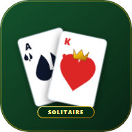

# 🃏 Klondike Solitaire PWA

A modern, fast, installable single-page Klondike Solitaire Progressive Web App (PWA). Playable anywhere, 100% offline, on iOS, Android, and Desktop.

🎮 **[Play Live Demo](https://glotoff.github.io/solitaire/)**



## ✨ Features

- **PWA & Offline First**: Installable on Android, iPhone/iPad, Windows, and Mac. Functions completely offline without an internet connection.
- **Fluid Controls**:
  - Drag and drop single cards or full tableau stacks with mouse, touch, or stylus.
  - **Smart Tap**: Tap any movable card to automatically place it in foundations or tableau columns.
  - **Double-tap**: Instantly send cards to their foundation piles.
- **Klondike Rules**:
  - Draw 1 (casual) and Draw 3 (classic tournament) modes.
  - Unlimited Undo history stack.
  - Hint assistant highlighting tactical legal moves.
  - **Auto-Complete**: Automatically finishes the game once all hidden cards are uncovered.
- **Classic Win Celebration**: Iconic bouncing card cascades and celebratory fanfare.
- **Zero-Dependency Audio**: Pure Web Audio API synthesized sound effects for dealing, flipping, placing cards, and victory melodies.
- **Customizable Themes**:
  - Table Felts: Emerald Casino, Midnight Navy, Royal Burgundy, Sleek Charcoal.
  - Card Backs: Blue Diamond Lattice, Vintage Bicycle Red, Royal Crown Gold, Dark Emerald.
- **Haptic Feedback**: Subtle vibration on mobile card snaps and drops (`navigator.vibrate`).
- **Retina & OLED Ready**: Sharp vector SVG graphics, responsive flex/grid layout, and safe-area notch support (`env(safe-area-inset-top)`).

## 📱 How to Install

### iPhone & iPad (iOS Safari)
1. Open [https://glotoff.github.io/solitaire/](https://glotoff.github.io/solitaire/) in Safari.
2. Tap the **Share** button (the square with an arrow pointing upward).
3. Scroll down and tap **"Add to Home Screen"**.
4. Launch "Solitaire" directly from your home screen for full-screen offline gameplay.

### Android (Chrome / Edge / Samsung Internet)
1. Open [https://glotoff.github.io/solitaire/](https://glotoff.github.io/solitaire/) in Chrome.
2. Tap the **"📲 Install"** button in the header bar (or open the browser menu `⋮` and select **"Install app"**).
3. Confirm installation. The game will be added to your app drawer and home screen.

## 🛠️ Local Development

Serve the root directory with any HTTP server (e.g. Python, Node, or VS Code Live Server):

```bash
# Using Python
python -m http.server 8000

# Or using npx serve
npx serve .
```

Navigate to `http://localhost:8000` in your browser.

## 📄 License

MIT License. Open source and free to enjoy.
